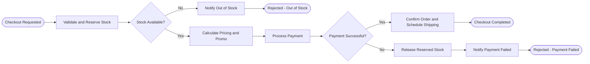

# Quarkus Marketplace Services

Project ini terdiri dari dua modul berbasis Java 17 dan Quarkus 3.8:

- `order-event-service`: Layanan pemrosesan event order dengan Kafka (SmallRye Reactive Messaging) dan penyimpanan database menggunakan Hibernate ORM Panache.
- `checkout-bpmn-service`: Layanan workflow checkout marketplace menggunakan BPMN 2.0 dan Kogito (`jbpm-quarkus`).

## Tech Stack

- Java 17
- Quarkus 3.8.6
- SmallRye Reactive Messaging Kafka
- Hibernate ORM with Panache (PostgreSQL & H2 untuk environment test)
- Kogito / jBPM Quarkus 10.0.0 (BPMN 2.0)
- JUnit 5 & REST Assured

---

## 1. Order Event Service (`order-event-service`)

Modul ini menerima event pesanan dari topic Kafka `raw-orders`, memvalidasi serta mengolah data transaksi, menyimpannya ke tabel `processed_orders`, lalu mengirimkan hasil olahannya ke topic `processed-orders`.

### Alur Proses & Manipulasi Data
1. Data masuk melalui topic `raw-orders` (atau dipicu lewat endpoint `POST /api/orders`).
2. `OrderProcessingService` melakukan normalisasi string (`orderId`, `customerId`, `category`, `promoCode`) dan validasi nilai `quantity` serta `unitPrice`.
3. Perhitungan nilai transaksi:
   - `grossAmount = unitPrice * quantity`
   - Diskon (`discountAmount`):
     - Promo `VIP20`: diskon 20%
     - Promo `PROMO10`: diskon 10%
     - Tanpa kode promo dengan `grossAmount >= 1000000`: diskon otomatis 5%
   - Pajak (`taxAmount`): 11% dari `(grossAmount - discountAmount)`
   - Total bersih (`netAmount`): `(grossAmount - discountAmount) + taxAmount`
   - Klasifikasi `transactionTier`:
     - `PLATINUM` (`netAmount >= 1000000`)
     - `GOLD` (`netAmount >= 500000`)
     - `REGULAR` (`netAmount < 500000`)
4. Data disimpan ke database melalui `ProcessedOrderRepository` dan dikirim ke topic `processed-orders`.

### Endpoint API (`http://localhost:8080`)
- `POST /api/orders` : Publish order event baru ke topic `raw-orders`
- `GET /api/orders` : Ambil semua data order yang sudah diproses
- `GET /api/orders/{orderId}` : Ambil detail order berdasarkan `orderId`
- Swagger UI : `http://localhost:8080/q/swagger-ui`

Contoh request `POST /api/orders`:
```json
{
  "orderId": "ORD-2026-001",
  "customerId": "CUST-101",
  "customerName": "Rina Kartika",
  "productName": "Life Protection Plan",
  "category": "INSURANCE",
  "quantity": 2,
  "unitPrice": 500000,
  "promoCode": "PROMO10"
}
```

---

## 2. Checkout BPMN Service (`checkout-bpmn-service`)

Modul ini memodelkan proses bisnis checkout marketplace menggunakan BPMN 2.0 (`src/main/resources/checkout.bpmn2`) yang dijalankan di atas Kogito.

### Ilustrasi Alur BPMN



### Penjelasan Service pada Proses BPMN

1. **`InventoryService`**
   - `reserveStock(CheckoutOrder order)`: Mengecek ketersediaan stok produk (valid jika `productId` bukan `PROD-OOS` dan `quantity` antara 1 sampai 50). Jika tersedia, stok di-reserve (`stockAvailable = true`, status `STOCK_RESERVED`). Jika tidak, `stockAvailable = false` dan status `FAILED_OUT_OF_STOCK`.
   - `releaseStock(CheckoutOrder order)`: Dipanggil pada jalur kompensasi saat pembayaran gagal untuk mengembalikan stok yang sebelumnya sudah di-reserve, lalu mengubah status menjadi `FAILED_PAYMENT`.

2. **`PricingService`**
   - `calculatePricing(CheckoutOrder order)`: Menghitung `subtotal` (`unitPrice * quantity`), potongan `discountAmount` (`PROMO10` sebesar 10%, `VIP20` sebesar 20%), biaya pengiriman `shippingCost` (Rp 25.000, atau gratis jika `subtotal >= 500000`), serta `totalAmount`.

3. **`PaymentService`**
   - `processPayment(CheckoutOrder order)`: Memvalidasi metode pembayaran dan nilai tagihan. Jika pembayaran berhasil, mengeset `paymentSuccess = true`, status `PAID`, dan membuat nomor referensi `PAY-<ORDER_ID>`. Jika metode pembayaran ditolak (`DECLINED` atau `INVALID_CARD`), mengeset `paymentSuccess = false`.

4. **`FulfillmentService`**
   - `confirmOrderAndShip(CheckoutOrder order)`: Mengonfirmasi pesanan yang berhasil dibayar, membuat nomor resi pengiriman `SHP-<ORDER_ID>`, dan mengubah status akhir menjadi `COMPLETED`.
   - `notifyRejection(CheckoutOrder order)`: Mengirimkan notifikasi penolakan pesanan beserta alasan kegagalannya (`rejectionReason`) ketika stok habis atau pembayaran gagal.

### Endpoint API (`http://localhost:8081`)
- `POST /checkout` : Menjalankan proses BPMN checkout
- Swagger UI : `http://localhost:8081/q/swagger-ui`

Contoh request `POST /checkout`:
```json
{
  "order": {
    "orderId": "CHK-001",
    "customerId": "CUST-101",
    "customerName": "Budi Santoso",
    "productId": "PROD-INS-01",
    "productName": "Comprehensive Vehicle Insurance",
    "quantity": 2,
    "unitPrice": 500000,
    "promoCode": "PROMO10",
    "paymentMethod": "VIRTUAL_ACCOUNT"
  }
}
```

---

## Cara Menjalankan

### Menjalankan Unit & Integration Test
Dari root directory:
```powershell
.\mvnw.cmd test
```

Atau per modul:
```powershell
cd order-event-service
.\mvnw.cmd test

cd ../checkout-bpmn-service
.\mvnw.cmd test
```

### Menjalankan Aplikasi (Dev Mode)
Pastikan PostgreSQL lokal sudah berjalan dan database `orders_db` sudah dibuat untuk `order-event-service`.

```powershell
# Jalankan order-event-service (port 8080)
cd order-event-service
.\mvnw.cmd quarkus:dev

# Jalankan checkout-bpmn-service (port 8081)
cd checkout-bpmn-service
.\mvnw.cmd quarkus:dev
```
